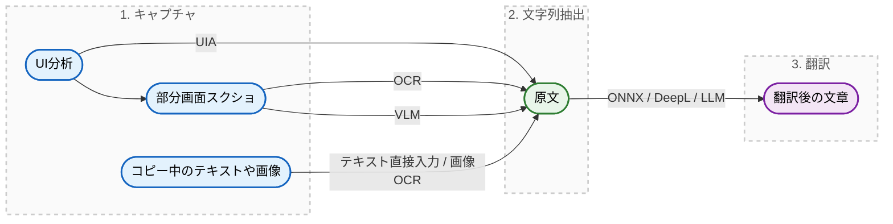
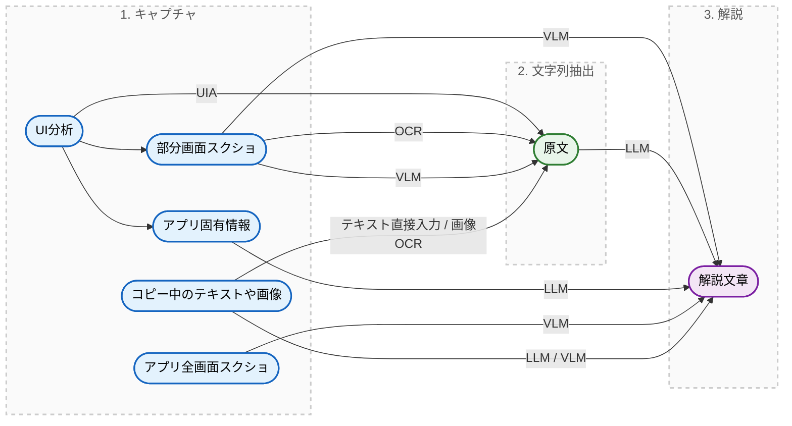
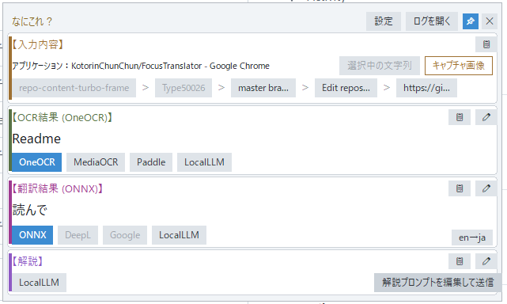
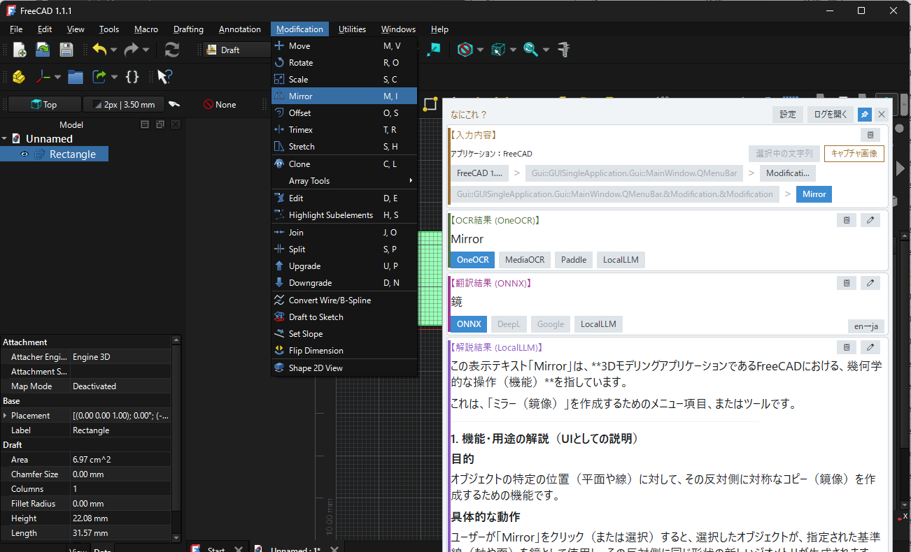
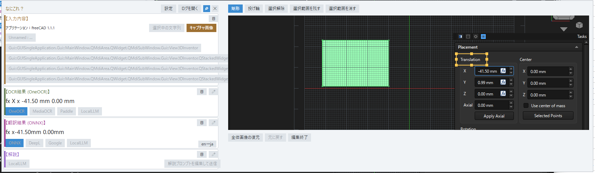
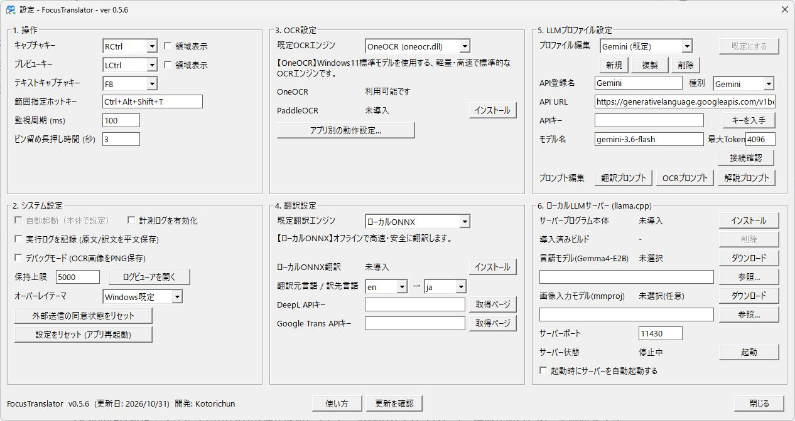
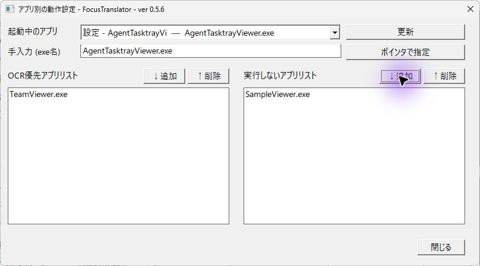
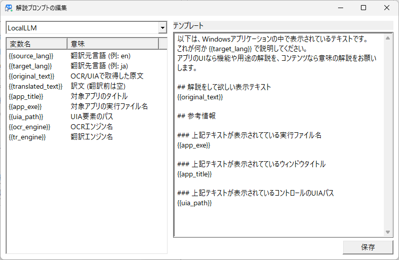
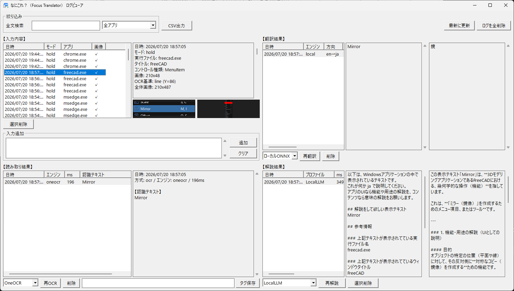

# なにこれ？（Focus Translator）

マウスポインタ直下のテキストを認識して、翻訳や解説をポップアップで表示するWindows用の常駐ツールです。

---

## 目次

- [プロジェクト概要](#プロジェクト概要)
- [仕組み](#仕組み)
- [主な機能](#主な機能)
- [対応環境](#対応環境)
- [インストール](#インストール)
- [アンインストール](#アンインストール)
- [使い方](#使い方)
  - [基本操作](#基本操作)
  - [オーバーレイ画面](#オーバーレイ画面入出力結果表示)
  - [キャプチャ編集画面](#キャプチャ編集画面)
  - [設定画面](#設定画面)
  - [プロンプト編集](#プロンプト編集)
  - [ログビューアー画面](#ログビューアー画面)
- [各種エンジンの対応状況](#各種エンジンの対応状況)
- [プライバシーとセキュリティ](#プライバシーとセキュリティ)
- [利用条件](#利用条件)
- [作者](#作者)

---

## プロジェクト概要

海外製のソフトウェアを使うとき、英語のメニューやボタン、エラーメッセージの意味がわからないたびに、テキストやスクリーンショットをコピーして翻訳サイトやチャットAIに貼り付けるのが煩わしく感じられました。

そこで「なにこれ？」と思ったときに、マウスカーソルが指す箇所をその場で翻訳・解説するツールを作りました。

ビルド手順、カスタマイズ方法、開発向けの情報は[開発ガイド](docs/DEVELOPERS_GUIDE.md)にまとめています。

## 仕組み

### 1. 翻訳文作成のフロー

### 2. 解説文作成のフロー

## 主な機能

初期設定では右Ctrlキーを押すとすぐに翻訳が表示され、キーを押している間だけ表示が続きます。キーを離すとすぐに元の作業に戻れます。

画像になっていてコピーできないテキストも、OCRで瞬時に読み取れます。

テキストを選択している場合は、選択した文字列を最優先で読み取ります。

翻訳結果だけでは説明が足りない場合は、画面の内容をもとに生成AIで解説できます。翻訳ソフトより分かりやすい説明が期待できます。

解説機能は、日本語のアプリで使い方が分からないときにも使えます。

| 機能                   | 説明                                                                                                                                                                                    |
| ---------------------- | --------------------------------------------------------------------------------------------------------------------------------------------------------------------------------------- |
| **即時キャプチャ**     | 設定したキャプチャキーを押している間、カーソル下のテキスト（テキスト選択中は選択部分を優先）をUIAやOCR等で取得します。離すと消えます。既定は右Ctrlです。 |
| **範囲指定キャプチャ** | `Ctrl+Alt+Shift+T` で範囲指定モードを起動し、ドラッグ選択した矩形を画像化しOCR処理します。選択中は重ねて起動せず、ESCで閉じられます。                                             |
| **クリップボード取込** | コピー中のテキストや画像をボタンクリックで取り込みます。リッチテキストはMarkdownへ変換し、プレーンテキストは空白や改行を保って取り込みます。                                     |
| **画像編集**           | スクリーンショットから必要な範囲を切り抜いてOCRの認識範囲を変更します。                                                                                                                 |
| **翻訳**               | 原文のキャプチャに続けて、テキストを翻訳した結果を表示します。                                                                                                                          |
| **解説**               | 生成AI（LLM）の力で、単なる翻訳にはできない用語の詳細な意味や用途の解説を行います。全体スクリーンショット送信を有効にすると、対象箇所を赤枠で示した画像から画面の文脈を踏まえた解説が得られます。 |
| **ログ取得**           | 過去の履歴をツリー構造で振り返り、再処理やCSV出力を行えます。                                                                                                                           |
| **モデル切り替え**     | 設定画面から高精度なOCR（PaddleOCR）、クラウドのAPIサービス、ローカルLLM（ONNX / llama.cpp）を切り替えることができます。                                                                |
| **LLMサーバー管理**    | ローカルLLMサービス（llama.cpp）を自身のパソコンに簡単に導入し、完全オフラインで動作させることができます。                                                                              |

## 対応環境

- **OS**: Windows 10 / 11
- OCRの要件
  - 既定のOCRエンジンである OneOCR は Windows 11 のみ対応しています。Windows 10 では精度の低い Windows.Media.Ocr を使うか、PaddleOCR をインストールしてください。

## インストール

本ツールはスタートアップ常駐を前提としています。以下の手順でインストールしてください。

1. [Releases](https://github.com/KotorinChunChun/FocusTranslator/releases) から `focus-translator-setup.exe` をダウンロードします。
2. インストーラを実行し、画面の指示に従ってインストールします。
   - 通常起動すると設定画面が開きます。KotorinToysで管理する場合の起動と設定は[連携ガイド](docs/kotorintoys-integration.md)を参照してください。
3. 初回起動時だけ、高精度なローカルOCR（PaddleOCR）とローカル翻訳モデル（ONNX）の導入を案内するダイアログが表示されます。「はい」を選んで設定画面を開き、各エンジンのインストールボタンから導入してください。
   - PaddleOCRを導入しない場合はWindows標準のOCR機能が使われます。ローカルで翻訳するには、翻訳モデルの導入が必要です。
4. 外部の生成AIを利用する場合は、APIキーを用意するか、対応するCLIにご自身のアカウントでサインインします。
   - 解説機能を使用するためには、LLMの設定が必須となります。
   - クラウドが利用できる場合は、GeminiやGPTを契約してAPIキーを入手し、設定画面から設定してください。
   - 外部に一切データを送信しない運用にする場合は、ローカルLLMサービス（llama.cpp）の導入をおすすめします。
5. 設定画面からローカルLLMサービス（llama.cpp）を導入できます。
   - 自動で導入するLLMおよびVLMはGoogleのGemma-4-E2Bに固定しています。
   - 導入するとストレージを3.5GB程度使います。快適に使うには相応のスペックが必要ですが、RAMが16GBある最近のPCであればGPUがなくても動作します。
   - 本ツールは汎用性を重視しています。GPUを使うサーバーはご自身で用意してください。

※ 既定では設定ファイルやモデルは `%APPDATA%\FocusTranslator\` に保存されます。

CLI対応版から以前の版に戻すときは、先にFocus Translatorを終了してください。設定フォルダーの `config.json` を別名で退避し、`config.before-cli.json` のコピーを `config.json` にしてから旧版を起動します。このバックアップにはCLIプロファイルが追加される直前の設定が入っています。

## アンインストール

Windowsの「アプリと機能」からアンインストールできます。アンインストールすると、本ツールは自動で終了し、起動中のローカルLLMサーバー（llama.cpp）も停止します。

続けて、`%APPDATA%\FocusTranslator\` 内に本ツールが作成したデータ（ログ・翻訳モデル・LLMサーバーとモデル・設定など）をすべて削除するか確認する画面が表示されます。「いいえ」を選ぶとデータが残ります。

## 使い方

設定画面とアプリ別の動作設定の画像は0.5.6のものです。ほかの画像は以前のバージョンの操作例です。キーの割り当てと利用できる認識・翻訳エンジンは、使用中のアプリの設定で確認してください。

### 基本操作

1. 意味を確認したい画面上の英単語やテキストにマウスカーソルを合わせます。
2. 右Ctrlキーを長押し（ホールド）します。
   - アプリがカーソル直下のテキストを自動で認識し、カーソル付近に翻訳画面を表示します。
3. キーを離すと翻訳画面が消え、すぐに元の作業に戻れます。

キャプチャキーは設定画面の「1. 操作」から変更できます。2つのコンボボックスでキーを1つずつ選び、両方を押している間だけ表示することができます。片方を「なし」にすると、もう片方のキーだけで表示されます。候補一覧は縦スクロールバーとマウスホイールで移動できます。左欄で左右指定のないCtrl／Shift／Alt／Winを選ぶと、同系統の左右指定を含む候補は右欄から除外されます。

F8を押している間にコピー対象を枠で表示し、キーを離すとクリップボードにコピーします。F8を押したまま左ドラッグすると範囲を指定できます。コピー対象がない場合はクリップボードの内容を保持します。キーは設定画面の「テキストキャプチャキー」で変更できます。

> 操作のコツ
>
> - テキストの一部を選択した状態で右Ctrlを押すと、選択した文字列を最優先で認識します。
> - 広い領域をドラッグで選び、画像として取得してOCRで読み取るには、`Ctrl + Alt + Shift + T` で範囲指定モードを起動します。Escでキャンセルできます。

---

### オーバーレイ画面（入出力結果表示）

キャプチャの直後にカーソル付近に表示されるメイン画面です。

読み取った原文は「OCR結果」、訳文は「翻訳結果」に表示されます。別の認識・翻訳エンジンを試すときは、各欄の下のボタンで選びます。

解説に対応するプロファイルを設定したら「解説」のボタンを押します。次の画像はFreeCADの「Mirror」を読み取り、用語とメニューの機能を表示した例です。

#### 画面構成

画面には上から順に4つのエリアがあります。

1. 入力エリア (UIの分析結果、スクリーンショット画像)
2. 原文エリア (OCR結果、UIテキスト、クリップボード)
3. 翻訳エリア
4. 解説エリア

各エリアの右上には **【コピー】ボタン** があります。認識されたUIA情報、原文、翻訳文、解説文などをクリップボードへコピーできます。

#### 1. 入力エリア (UIの分析結果、スクリーンショット画像)

- 右Ctrlを長押しすると、UI構造の分析結果（UIA）やカーソル周辺のスクリーンショットが自動で取り込まれます。
- テキスト選択部分や `Ctrl + Alt + Shift + T` での範囲指定、およびクリップボード内のテキスト/画像もこの入力エリアに取り込まれます。
- 認識範囲が適切でない場合は、【キャプチャ画像】ボタンから画面を拡大表示し、投げ輪や矩形で切り抜いて再度OCRで読み取れます。
- クリップボードにテキストや画像があると【コピー中の内容】ボタンが有効になります。ボタンを押すと新しい入力として直接取り込み、翻訳できます。HTMLやRTFはMarkdownに変換し、プレーンテキストは空白や改行を保ちます。

#### 2. 原文エリア (OCR結果、UIテキスト、クリップボード)

- 入力エリアの内容をOCRやテキスト抽出で読み取った英語の原文が、画面上部の小さな枠に表示されます。
- マウスを重ねると全文を拡大して確認できます。テキストを選択してキャプチャした場合は、選択範囲が優先して表示されます。
- 各ボタンを押すと、対応するOCRエンジンで再度文字起こしを試します。LLMプロファイルのボタンにマウスを重ねると、そのプロファイルへの直近1時間の送信回数と合計トークン数がツールチップに表示されます。
- OCRエンジンの性質上、入力内容によっては認識精度が著しく低下することがあります。その場合は【キャプチャ画像】ボタンから対象画像を切り抜く必要があります。
- LLMを設定している場合は、LLM（VLM）で高精度に文字起こしできます。ただし処理は非常に低速です。

#### 3. 翻訳エリア

- 既定の翻訳エンジンによる日本語訳が表示されます。
- `%E6%B5%B7...`のように`%`と16進2桁が2組以上連続する文字列は、翻訳エンジンへ送らず自動的にデコードします。この場合は【パーセントデコード結果】と表示され、翻訳エンジンのボタンはすべて未選択になります。
- 各ボタンを押すと、対応する翻訳エンジンで再度翻訳を試します。LLMプロファイルのボタンにマウスを重ねると、使用状況がツールチップに表示されます。
- 翻訳エンジンの性質上、入力内容によっては訳が適切でないことがあります。精度の高い翻訳を行うにはLLMの使用を推奨します。ただし処理は非常に低速です。

#### 4. 解説エリア

- 入力のテキストと画像をもとに生成AI（LLM/VLM）が言葉の意味やアプリのUIを詳しく解説します。
- 同じ内容を解説した履歴があれば、自動でプレビューが表示されます。
- 各ボタンを押すと、対応するプロファイルで生成AIに詳細な解説を求めます。ボタンにマウスを重ねると使用状況がツールチップに表示されます。
- 【解説プロンプトを編集して送信】ボタンを押すとプロンプト編集画面が開きます。

#### その他

- **【使い方】ボタン**: テキストの抽出、翻訳、AIによる解説で利用できる主な機能を簡潔に確認できます。BossGuard有効時は、この画面にも製品名を表示しません。
- 【設定 ⚙️】ボタンで設定画面を開けます。
- 【ログ 📜】ボタンでログビューアー画面を開けます。
- カラーテーマは設定画面で「Windows既定 / ライト / ダーク」から選べます。

---

### キャプチャ編集画面

オーバーレイ画面の【キャプチャ画像】ボタンから、その場で画像を編集できます。

自動で検出された範囲が適切でない場合は、投げ輪や矩形で必要な箇所を切り抜き、その部分だけをOCRで読み取れます。

### 設定画面

通常起動するか、タスクトレイから設定画面を開きます。まずキーの割り当てと翻訳エンジンを選びます。モデルが「未導入」の場合は、利用するものだけを導入してください。

「アプリ別の動作設定」でexe名を入力し、右側の「追加」を押すと、そのアプリを認識の対象から除外できます。次の画像は説明用の `SampleViewer.exe` を登録した状態です。

タスクトレイアイコンを左クリックしても設定画面を開けます。右クリックすると従来通りメニューが表示されます。設定画面には「1. 操作」「2. システム設定」「3. OCR設定」「4. 翻訳設定」「5. LLMプロファイル設定」「6. ローカルLLMサーバー (llama.cpp)」の6グループがあります。

- 操作・OCR設定ではホットキーや既定のOCRエンジンを選べます。選択中のエンジンの特徴は選択欄のすぐ下に表示されます。【アプリ別の動作設定】ボタンで別のウィンドウを開き、2つの一覧を管理できます。プレビューキーの初期設定は「なし」です。

  「OCR優先アプリリスト」はTeamViewerやリモートデスクトップなど、画面の内容がUIAと一致しないアプリに使います。登録したアプリは常にOCRで読み取ります。TeamViewer.exeは既定で登録されています。「実行しないアプリリスト」に登録したアプリ上では、ホットキーを押しても認識・オーバーレイ表示を一切行いません。

  追加するには、起動中のアプリ一覧から選ぶ、exeファイル名を直接入力する、対象ウィンドウをクリックして指定する、のいずれかでexe名を手入力欄に入れます。登録先のリストの【↓追加】ボタンを押して確定します。登録を解除するときは、リストでアプリを選んで【↑削除】を押します。登録先は中央の【→ 移動】【← 移動】で変更できます。
- システム設定では、アプリ全体の画像をLLMに添付できます。初期設定はOFFです。【BossGuard（アプリ名・開発者名を隠す）】では、本アプリの名称と開発者名を空白にできます。
- 翻訳設定では既定の翻訳エンジンとAPIキー（DeepL / Google / Gemini等）を設定できます。
- LLMプロファイル設定では業務分野に合わせた解説用プロンプトと応答の最大トークン数をプロファイルごとに設定できます。種別は Gemini / OpenAI(GPT) / Claude / llama.cpp(ローカル) / Hugging Face / OpenRouter / GitHub Models / NVIDIA NIM / Ollama(ローカル) / LM Studio(ローカル) に加え、Codex CLI / Claude CLI / GitHub Copilot CLI / Gemini CLI / Kimi Code CLIから選べます。

  名前・種別・URL・APIキー・モデル名・最大Tokenの各項目は、入力欄からフォーカスを外すと自動で保存されるため、保存ボタンを押す必要はありません。「複製」ボタンで別のプロファイルを作ってから編集することもできます。APIキー欄の右にある「キーを入手」ボタンで、選択中のサービスのキー発行ページを直接開けます。【モデル取得】を押すとモデル候補が表示されます。モデル名は直接入力もできます。CLIを使う場合は事前に各CLIへサインインします。「接続先 / CLI」が空欄ならPATHから検出します。任意のプロファイルを「既定にする」と、右Ctrlまたは範囲指定で起動したときに使われます。
- ローカルLLM(llama.cpp)では、llama.cpp本体とモデル（Gemma 4 E2B等）をワンクリックで導入できます。サーバーの起動・停止と、自動起動の設定もできます。インストール時はCPU版・CUDA版(NVIDIA GPU)・Radeon版(AMD GPU)から選べます。検出したGPUに応じて推奨マークが表示されます。導入済みのビルド種別はいつでも確認でき、不要になったら停止して削除できます。サーバーの既定ポートは11430です。

  mmproj（画像入力対応用ファイル）を導入すると、ローカルLLMで画像のOCRもできます。モデルやmmprojのファイルが既定の保存先にある場合は、次回起動時にパス欄へ自動入力されます。

設定画面やログビューアが非表示の場合は、同じボタンやタスクトレイメニューから前面へ戻せます。

### プロンプト編集

プロンプト編集画面では `{{original_text}}` などの変数を使って、LLMに送信する命令文を細かく調整できます。最前面に表示される専用ウィンドウで、テンプレートの編集と送信内容のプレビューを別々に扱えます。

全体画像の送信を有効にしている場合は、【画像を開く】から送信対象の赤枠付き画像を確認できます。

### ログビューアー画面

ログビューアー画面では本ツールの入出力履歴をツリーで確認し、再処理やCSV出力ができます。履歴はローカルのSQLiteに安全に保存されます。

## 各種エンジンの対応状況

**OCRエンジン対応状況**

| エンジン                          | 種別          | 条件                             |
| --------------------------------- | ------------- | -------------------------------- |
| OneOCR (oneocr.dll)               | OCR (既定)    | Windows 11のみ対応               |
| Windows.Media.Ocr                 | OCR           | Windows 10, 11対応               |
| PaddleOCR                         | OCR           | 要インストール                   |
| クラウドLLM (Gemini, Claude, GPT, Hugging Face, OpenRouter, GitHub Models, NVIDIA NIM) | OCR+翻訳+解説 | 要APIキー |
| ログイン済みLLM CLI (Codex, Claude, GitHub Copilot, Gemini, Kimi Code) | OCR+翻訳+解説 | 各CLIの導入・ログインが必要 |
| ローカルLLM (llama.cpp)           | OCR+翻訳+解説 | 要インストール＆サーバー実行 (※) |
| ローカルLLM (Ollama, LM Studio)   | OCR+翻訳+解説 | 別途導入・起動が必要 (APIキー不要) |

_(※) ローカルLLMでOCRを行う場合は、設定画面「6. ローカルLLM」からmmprojファイルを追加導入した上でサーバーを起動してください。_

**翻訳エンジン対応状況**

| エンジン                          | 種別          | 条件                         |
| --------------------------------- | ------------- | ---------------------------- |
| ローカルONNX                      | 翻訳 (既定)   | 要インストール               |
| DeepL                             | 翻訳          | 要APIキー                    |
| Google翻訳                        | 翻訳          | 要APIキー                    |
| クラウドLLM (Gemini, Claude, GPT, Hugging Face, OpenRouter, GitHub Models, NVIDIA NIM) | OCR+翻訳+解説 | 要APIキー |
| ログイン済みLLM CLI (Codex, Claude, GitHub Copilot, Gemini, Kimi Code) | OCR+翻訳+解説 | 各CLIの導入・ログインが必要 |
| ローカルLLM (llama.cpp)           | OCR+翻訳+解説 | 要インストール＆サーバー実行 |
| ローカルLLM (Ollama, LM Studio)   | OCR+翻訳+解説 | 別途導入・起動が必要 (APIキー不要) |

## プライバシーとセキュリティ

本アプリはパソコン上の画面を取得するという性質上、業務利用も想定してセキュリティに最大限配慮しています。

- 既定構成 (Windows OCR + ローカル翻訳) では**外部へのデータ送信は一切行われません**。
- クラウドAPI（Gemini, DeepL等）を利用する際は、初回送信時にユーザーの同意ダイアログを表示し、許可を得た場合のみ送信します。同意が無い場合は代替送信を行わず、処理自体を実行しません。
- 【アプリ全体のスクリーンショットをLLMに送信する】は既定でOFFです。ONにした場合は赤枠外を含む対象アプリ全体の表示内容も送信対象になるため、機密情報が映り込んでいないことを確認してご利用ください。外部サービスへ画像を初めて送る際は、画像送信についても同意を確認します。
- LLM CLIを利用する場合も入力テキストや画像は各社サービスへ送信されるため、クラウドAPIと同じ同意確認の対象です。CLIはリクエストごとの一時フォルダで起動し、利用可能な範囲でファイル変更・シェル実行・Web検索を無効化します。一時ファイルは処理後に削除されます。
- ローカルLLM（llama.cpp等、localhostを指すプロファイル）への送信はPC外へのデータ送信に該当しないため、同意なしで利用できます。
- 登録されたAPIキー等の機密情報は、Windowsの DPAPI（Data Protection API）で暗号化してローカルに保存され、ログ出力時には必ずマスクされます。
- 既定ではログを記録しません。必要に応じて設定画面で記録を有効にでき、ログはいつでも削除できます。

---

## 使用言語とライブラリ

- 使用言語はRustです。
- windows（Windows APIとOCR）、ort（ONNX Runtime）、tokenizers（モデル入力の分割）、rusqlite（SQLite）、ureq（HTTP通信）、pulldown-cmark（Markdown処理）。
- 依存定義と資料 [Cargoの依存定義](Cargo.toml)

## 利用条件

- 本アプリの独自コードと文書には[MITライセンス](LICENSE)が適用されます。第三者のコンポーネントや素材には、それぞれのライセンスが適用されます。
- クラウドサービスを使用したことによる情報流出や、その後の利用に関する制限は、利用者の責任において管理されるものとします。
- 本ツールを使用したことにより発生したいかなる損害も作者は責任を負いません。
- バグや追加してほしい機能などがあれば、GitHubのIssuesやTwitterなどでお知らせください。

---

## 作者

**ことりちゅん** ([@KotorinChunChun](https://github.com/KotorinChunChun))
